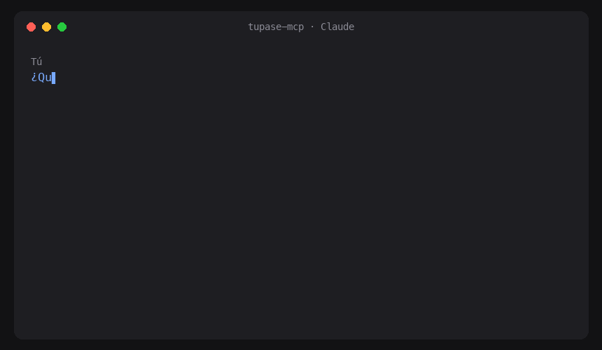

# tupase-mcp

**English** | [Español](README.es.md)

Search, book and cancel classes on [Tupase](https://www.tupaseapp.com) by talking to Claude, Cursor or any [MCP](https://modelcontextprotocol.io) client. Tupase is a fitness and sports membership app used in Uruguay.

> **Unofficial client.** This project has no relationship with Tupase and does not have its approval. It uses the app's private API with **your own account** and at your own risk: Tupase could change the API or restrict access at any time.

It runs on your computer and talks directly to Tupase. There is no intermediate server, and nobody else sees your data.

## What you can ask



*Real search on Tupase (the demo is in Spanish). The booking stays as a preview until you confirm, so nothing was booked in this demo.*

Other things that work:

- "What are my bookings this week? Show me the QR code of the first one."
- "Save Zona Fit as a favorite and search only in my favorites."
- "What is my routine? Tell me which dates I can book for my usual classes."
- "Which neighborhoods have activities this week?"
- "Cancel my booking for tomorrow."

## Installation

You need [uv](https://docs.astral.sh/uv/).

**1. Log in once.** It asks for the email and password of your Tupase account. The password is not stored: only a renewal token is kept in your system keychain.

```bash
uvx tupase-mcp login
```

**2. Add the server to your client.**

Claude Code:

```bash
claude mcp add tupase -- uvx tupase-mcp
```

Claude Desktop (`claude_desktop_config.json`) and Cursor (`~/.cursor/mcp.json`):

```json
{
  "mcpServers": {
    "tupase": { "command": "uvx", "args": ["tupase-mcp"] }
  }
}
```

Restart the client and ask something, for example "who am I on Tupase?", to check that the session works.

To log out: `uvx tupase-mcp logout`.

**Linux without a desktop (servers, WSL, Docker):** there is no system keychain available. Install a Secret Service backend (for example `gnome-keyring`) or the `keyrings.alt` package before logging in. Otherwise, `login` will tell you that the keychain could not be used.

## Tools

| Tool | What it does |
|---|---|
| `buscar_actividades` | Search by date and time, discipline, neighborhood, place, distance or favorites only. Maximum 7 days and 50 results per query |
| `listar_disciplinas` | Disciplines available in a date range |
| `listar_barrios` | Neighborhoods with activities in a date range |
| `ver_lugar` | One place with all its activities for the next 7 days |
| `mis_reservas` | Your bookings, with the real status (it checks your notifications) |
| `reservar` | Books an activity |
| `cancelar_reserva` | Cancels a booking by its code |
| `ver_qr_reserva` | Returns the code and the QR of a booking as an image |
| `mi_rutina` | Detects your usual classes (same place, day and time, at least 2 times) and lists their next bookable dates |
| `agregar_favorito`, `quitar_favorito`, `mis_favoritos` | Favorite places, stored on your computer |
| `quien_soy` | Your profile and the account status |
| `editar_perfil` | Updates your profile data |
| `mis_notificaciones` | Your notifications |
| `mis_medios_de_pago` | Your registered payment method (read only; Tupase may answer with an error depending on the account) |

The tool names and the messages returned by the server are in Spanish, because that is the language of Tupase. Your assistant will translate them for you.

## Safety

`reservar`, `cancelar_reserva` and `editar_perfil` change data in your account, so they have an extra step: without `confirmar=true` they only return a preview, and Claude must show it to you and wait for your confirmation before repeating the call.

- The "destructive" mark of a tool is only a hint: each MCP client decides if it asks for confirmation, and if you chose "always allow" for those tools, they run without asking. **Do not choose "always allow" for those three tools.**
- Tupase results include text from third parties (place names, notifications) that could contain hidden instructions for the model. The `confirmar` step reduces that risk, but it does not remove it: check what Claude shows you before you confirm.

## Notes

- **Peak hours:** Tupase returns at most 499 results per query. To give you everything, the server splits the search by time ranges and by discipline. A full hour at a busy time can take about 20 seconds. Filtering by discipline, neighborhood or place makes it instant.
- **Booking status:** some bookings stay as "pending confirmation" until the place confirms them. `mis_reservas` shows them as confirmed when Tupase notifies you that you got the spot.
- **Time zone:** all dates are read and shown in Montevideo time.
- **If something fails:** the server writes diagnostic messages to the log of the MCP client (stderr), never your credentials.

## Privacy

- The renewal token is stored in the system keychain (Keychain, Credential Manager or Secret Service). Your password is never stored.
- Favorites are stored in a local file in your user data directory.
- Nothing is sent to third parties: the only traffic is between your computer, Auth0 (the Tupase login) and the Tupase API.

## Development

```bash
uv sync
uv run pytest
uv run ruff check --fix . && uv run ruff format .
```

The tests do not use the network or your keychain. To try the tools by hand: `npx @modelcontextprotocol/inspector uv run tupase-mcp`. The endpoints used by the client are described in [`docs/api.md`](docs/api.md) (in Spanish).

## License

MIT
